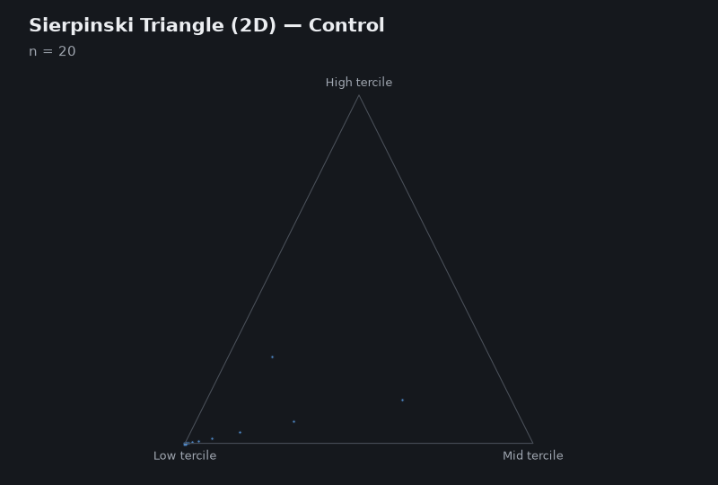

# FractalApp

[](https://github.com/Richard7987/Multiscale-Fractal-Complexity-of-Cardiac-Variability-A-Biomarker-for-Seizures/actions/workflows/tests.yml)
[](https://github.com/Richard7987/Multiscale-Fractal-Complexity-of-Cardiac-Variability-A-Biomarker-for-Seizures/releases/latest)
[](LICENSE)

Fractal dimension of physiological time series (heart rate variability, gait) through the Chaos Game: each series is mapped onto a Sierpinski triangle (2D) and tetrahedron (3D), and the fractal dimension `D` is estimated by box-counting.

<p align="center">
  
</p>

## Download

Windows and Linux executables are attached to each [release](https://github.com/Richard7987/Multiscale-Fractal-Complexity-of-Cardiac-Variability-A-Biomarker-for-Seizures/releases/latest). No Python installation is needed.

## Run from source

Requires Python 3.9+ with Tkinter.

```bash
pip install -r requirements.txt
python src/interfaz2d3d.py
```

Open a series with **Browse**, then choose **Control**, **Patient** or **Random** under the triangle or tetrahedron. Example RR series are in `data/`.

Whole folders can be analysed from the command line:

```bash
python src/fractal_batch.py data/controls data/epileptics -o results.csv
```

The [guide](docs/guide.md) covers the method, settings, statistics, input formats, batch options and tests.

## Credits

Original work by Alma Rocío Patiño-Chávez, Gael Aguirre-Cruz, Erik Leonardo Mateos-Salgado, Salvador Quiroz-González, Federico Menéndez-Conde Lara and Erika Elizabeth Rodríguez-Torres ([analisisenales](https://github.com/analisisenales/Multiscale-Fractal-Complexity-of-Cardiac-Variability-A-Biomarker-for-Seizures)). This fork is maintained separately while they prepare their paper. If you use it, please cite:

> Patiño-Chávez, A. R., Aguirre-Cruz, G., Mateos-Salgado, E. L., Quiroz-González, S., Menéndez-Conde Lara, F., & Rodríguez-Torres, E. E. *Fractal-HRV-Analyzer: A Multiscale Software Framework to Analyze Seizures via Chaos Game Mapping.*

MIT License.
